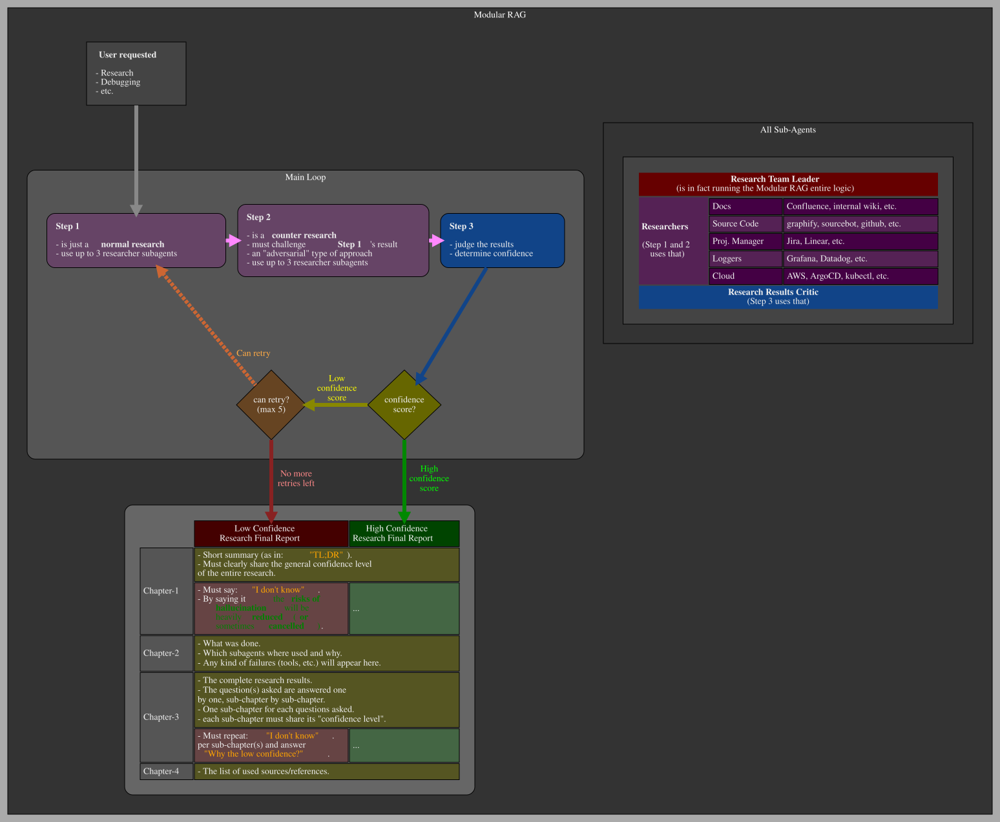
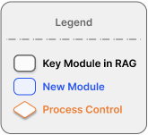
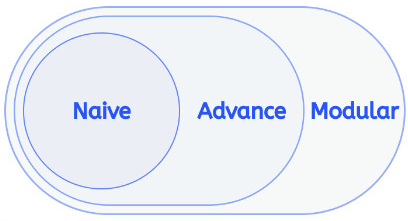
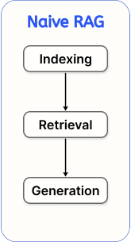
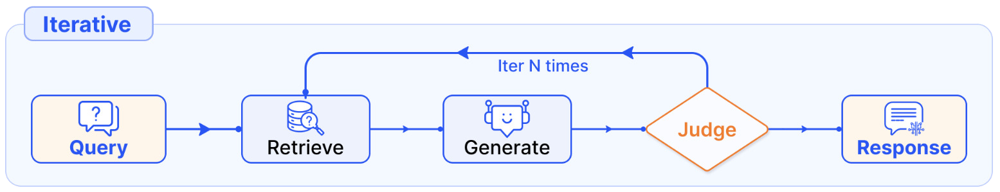
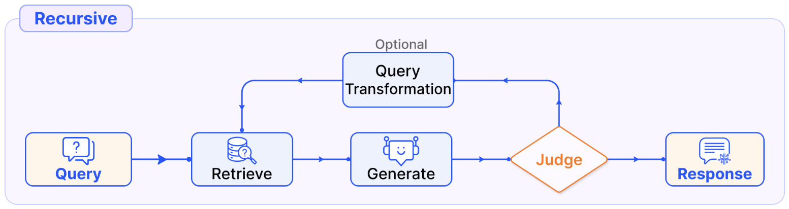
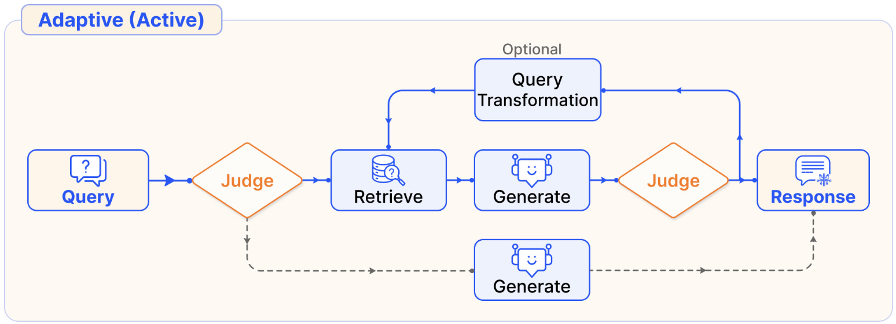
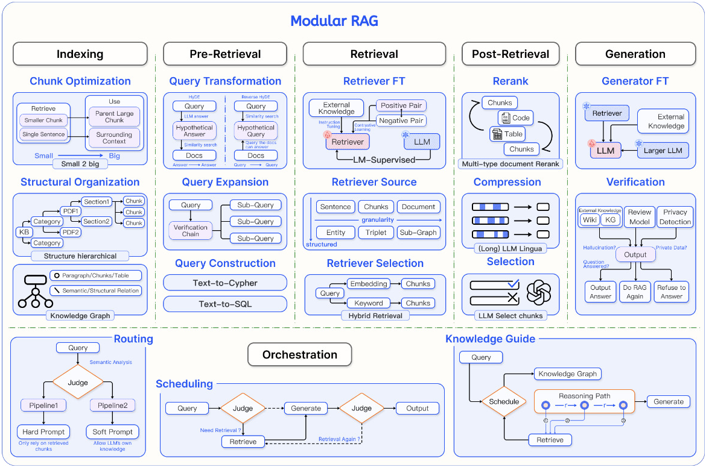

# Modular RAG

## TL;DR

The research happen "inside a loop"

ex of request: `I need a research about X.`

Here assuming a "Modular RAG based researcher skill/subagent".

### The loop
- <u>**STEP 1**</u>:
  - do research about X
- <u>**STEP 2**</u>:
  - now challenge the results from `STEP 1` with a counter-research
    - think of it as an "adversarial approach"
- <u>**STEP 3**</u>:
  - compare the results from `STEP 1` and `STEP 2`
  - consider a `confidence level/score` from those results
  - `IF`
    - the `confidence level/score` is "high enough"
    - `THEN`
      - `STOP` and return the results to the caller
      - the final `confidence level/score` can also be shared
  - `ELSE`
    - `REPEAT` from `STEP 1`
    - a maximum number of `REPEAT` must be setup (ex: 5)
    - `IF`
      - there is no more `REPEAT` left
      - and <u>**the confidence level/score is still too low**</u>
      - `THEN`
        - it <u>**MUST**</u> clearly reply to the caller `"I don't know"`.
          - this is will drastically the reduce/cancel the risk of hallucinations.

### Diagram

## Official Research Paper

- https://arxiv.org/html/2407.21059v1

## Legends

## Naive RAG

## Advanced RAG

## Loop
### "Iterative" Modular RAG

### "Recursive" Modular RAG

### "Adaptive" Modular RAG

## "Full" Modular RAG

