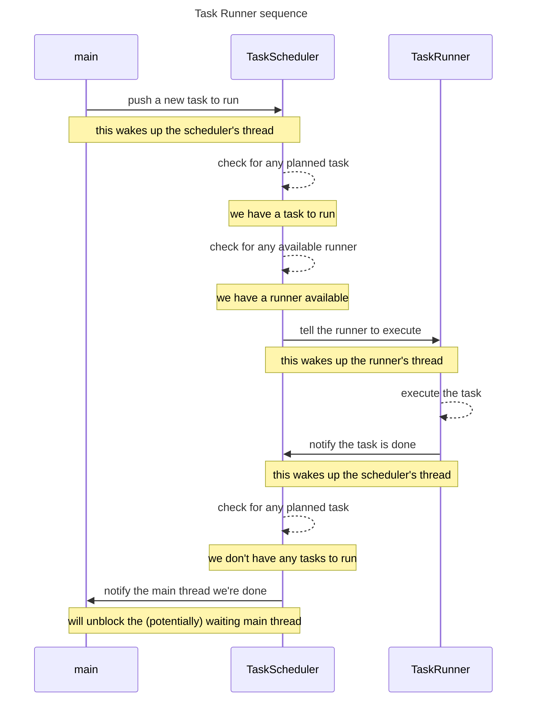
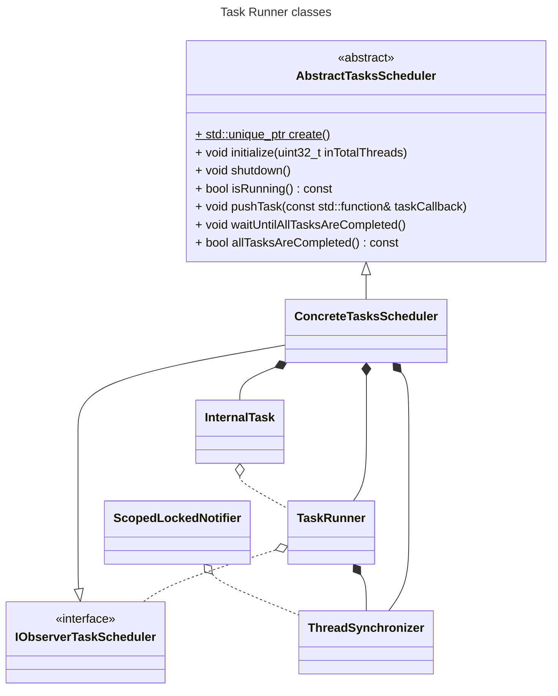

# Multithreading - "Tasks Runner" (small project)

## How to Use

```c++
#include "./tasks-runner/AbstractTasksScheduler.hpp"

#include <cstdio>
#include <thread>
#include <chrono>

int main()
{
    // note: taskScheduler is a unique_ptr
    auto taskScheduler = AbstractTasksScheduler::create();

    constexpr uint32_t k_totalThreads = 2;
    taskScheduler->initialize(k_totalThreads);

    // schedule a task
    // note: tasks are callbacks (std::function<void()>)
    taskScheduler->pushTask([]()
    {
        // ...simulated work...
        std::this_thread::sleep_for(std::chrono::milliseconds(500));
    });

    // schedule another task
    taskScheduler->pushTask([]()
    {
        // ...simulated work...
        std::this_thread::sleep_for(std::chrono::milliseconds(500));
    });

    // this will block the calling thread (here -> main thread)
    taskScheduler->waitUntilAllTasksAreCompleted();

    taskScheduler->shutdown();

    return EXIT_SUCCESS;
}
```

## How to Build

```bash
cmake -B ./build
cd ./build || exit 1
cmake --build . --parallel
```
...or just
```bash
sh sh_run.sh
```

## How to Run

```bash
./build/multi-threading
```

## Diagrams
### Sequence Diagram



### Class Diagram

Some details:
* pImpl (pointer to implementation):
    * AbstractTasksScheduler::create() will hide the ConcreteTasksScheduler logic
* Producer-Consumer Pattern:
    * the TaskScheduler "produce" tasks
    * a TaskRunner "consume" tasks
* Observer pattern (simplified):
    * this was heavily simplified -> no subscribe/register methods, just a notify method
    * a TaskRunner will "notify" the TaskScheduler once a task is completed


